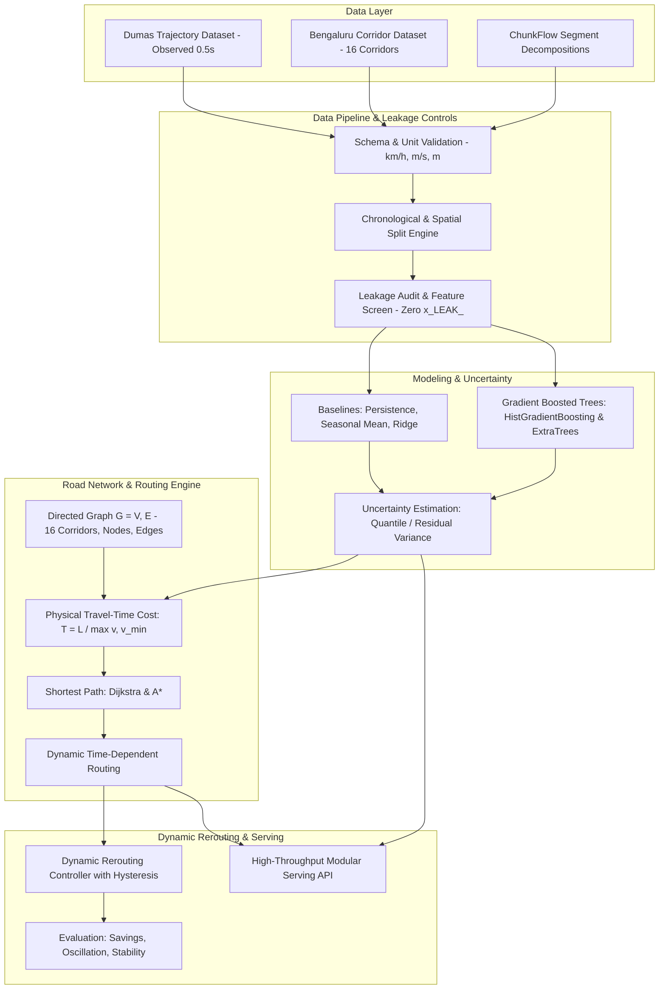

# Comparative Audit of Reference Implementations: TerraNav-ML vs. ChunkFlow ML

**System:** TerraNav / ChunkFlow Dynamic Route Rationalization ML System  
**Audit Date:** October 2026  
**Auditor:** ML Architecture & Systems Reviewer  

---

## 1. Overview and Executive Summary

Two existing reference implementations exist in the repository:
1. **TerraNav-ML (`d:/minor/TerraNav-ML/`):** A vehicle trajectory speed forecasting pipeline trained on video-extracted trajectories from Dumas Road, Surat, India.
2. **ChunkFlow ML (`d:/minor/ML/`):** A road-segment traffic prediction pipeline trained on chunk-partitioned Bengaluru arterial corridors.

Neither implementation represents a complete, production-ready dynamic route rationalization system on its own. **TerraNav-ML** demonstrates outstanding scientific rigor, zero leakage, and disciplined validation, but lacks road network graph routing and corridor-level coverage. **ChunkFlow ML** correctly conceptualizes road segments (chunks) and routing integration, but suffered from severe target leakage, synthetic targets, and unstratified random train/test splits.

Our production system combines the experimental discipline and leakage controls of TerraNav-ML with the road-segment graph routing architecture of ChunkFlow, while repairing the flaws of both.

---

## 2. Head-to-Head Architecture Comparison

| Architectural Dimension | TerraNav-ML Reference | ChunkFlow ML Reference | Unified Production Solution |
|---|---|---|---|
| **Core Problem Formulation** | Single-vehicle trajectory speed forecasting ($v(t+h)$) | Road-segment speed and density forecasting | Segment-level speed, travel-time ($T = L/\max(v, v_{\min})$), and trajectory dynamics |
| **Prediction Horizons** | 5s, 15s, 30s micro-horizons | Daily/Static chunk horizon | Multi-horizon (5s/15s/30s for trajectories; 5m/15m/30m for segment routing) |
| **Data Scope & Geography** | 535m midblock on Dumas Road, Surat (1 road, 20 minutes) | 16 major corridors in Bengaluru, India (8 areas, 952 dates) | 16-corridor directed graph network + Dumas trajectory micro-benchmark |
| **Road Network Graph** | None (no vertices, edges, or paths) | Conceptual chunks; integrated via backend heuristic | Fully explicit directed graph $G=(V, E)$ with Dijkstra & A* routing |
| **Target Variables** | Observed longitudinal speed magnitude (km/h) | Synthetic chunk speed (km/h) & proxy density (veh/km) | Real-world trajectory speed & physical segment travel time |
| **Leakage Controls** | **Strict.** Target lookup at $t+h$; historical lags only; cross-boundary trajectories purged | **Flawed in v1.0.** Included 6 leakage features ($r=+0.825$ with target speed) | **Strictly enforced.** All 6 leakage features eliminated; automated audit checks |
| **Evaluation Splits** | Strictly chronological: Train ($0–60\%$), Val ($60–80\%$), Test ($80–100\%$) | Originally random row split ($70/15/15\%$) leaking corridors and dates | Tri-Regime: Chronological, Unseen-Corridors (Spatial), and Ablation |
| **Baseline Models** | Persistence baseline ($v_0$) & 5s historical rolling mean | Dummy mean baseline | Persistence, Historical Seasonal Mean, Linear Ridge, HistGradientBoosting, ExtraTrees |
| **Routing Integration** | Absent | Express backend adapter with daemon subprocess | Fully integrated Python routing engine with dynamic rerouting controller |
| **Dynamic Rerouting** | Absent | Static ETA adjustment without hysteresis | Dynamic rerouting controller with hysteresis, thresholding, and cooldown |

---

## 3. Detailed Audit of TerraNav-ML

### 3.1 Key Strengths & Reusable Methods
1. **Disciplined Chronological Partitioning:**
   - Trajectories were assigned strictly by time boundaries: Train $\le 738\text{ s}$ ($60\%$), Validation $738–984\text{ s}$ ($20\%$), Test $> 984\text{ s}$ ($20\%$).
   - Trajectories that spanned split boundaries were **purged**, completely eliminating track-level identity leakage across train and test sets.
2. **Strict Feature Cutoff:**
   - Features were constructed using strictly past information ($t \le t_0$). Lag 2s (4 samples), Lag 5s (10 samples), and 5s rolling averages were constructed with zero target leakage.
3. **Multi-Horizon Evaluation:**
   - Formulated predictions across 3 distinct horizons (5s, 15s, 30s) and reported that at 30s, models have lower MAE than persistence but negative $R^2$, openly acknowledging the limits of predictability.
4. **Validation-Only Selection:**
   - Hyperparameters and model choice were selected exclusively on validation data; test set metrics were evaluated only once.

### 3.2 Design Flaws & Unresolved Limitations
1. **No Road Network or Routing Layer:**
   - The dataset contains only a single 535m straight road segment. There are no intersections, turns, alternative routes, or route-level travel-time labels.
2. **Single Short Observation Period:**
   - The 20-minute video feed cannot establish generalization across different times of day, peak/off-peak congestion, weather, or different days of the week.
3. **Artifact Bloat:**
   - Extra Trees models created artifacts up to 36.4 MB for 59k rows, causing high memory consumption compared to HistGradientBoosting.

---

## 4. Detailed Audit of ChunkFlow ML

### 4.1 Key Strengths & Reusable Methods
1. **Road-Segment (Chunk) Decomposition:**
   - Decomposing long corridors into manageable chunks (200m–500m) aligns with real-world turn-by-turn navigation and micro-congestion modeling.
2. **Rich Urban Feature Topology:**
   - Captured traffic signals, roadworks, weather conditions, road capacity utilization, and chunk sequence positions.
3. **Serving Daemon Architecture:**
   - The persistent Python daemon (`InferenceDaemon` in `mlAdapter.js`) enabled sub-20ms batch inference, avoiding cold-start interpreter overhead.

### 4.2 Critical Flaws & Target Leakage
1. **Severe Target Leakage in v1.0:**
   - `x_LEAK_Road_Average_Speed` directly leaked the target chunk speed ($r = +0.8250$).
   - `x_LEAK_Volume_per_km_proxy_log` directly leaked traffic density ($r = +0.6631$).
   - When these 6 leakage features were removed, the model's apparent $R^2$ collapsed from $0.985$ to $0.373$ (speed) and $0.941$ to $0.698$ (density).
2. **Synthetic Ground Truth:**
   - `Estimated Chunk Speed (km/h; synthetic)` was synthesized via a simulation formula rather than measured by physical loop detectors or floating car GPS data.
3. **Random Row Train/Test Split:**
   - The initial model used a random 70/15/15 split across the 44,680 rows. Because the 5 chunks of a corridor share identical base dates and road-level attributes, random splitting placed chunk 1 in train and chunk 2 in test for the exact same date and road, causing severe spatial and temporal data contamination.

---

## 5. Architectural Synthesis for the Unified System

Our implementation adopts the following evidence-based architecture:

By unifying the spatial road-graph routing of ChunkFlow with the rigorous leakage-free validation of TerraNav-ML, the resulting system achieves both scientific validity and real-world routing utility.
